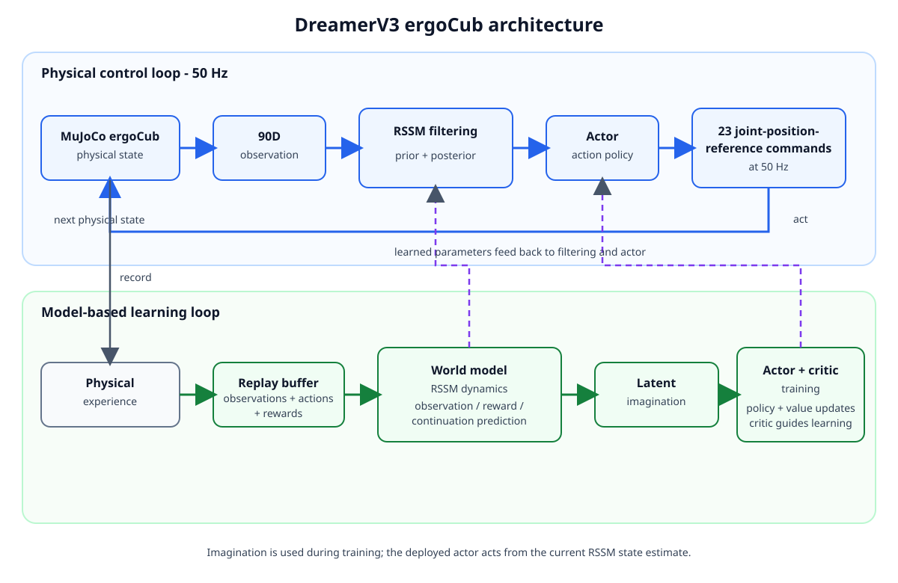
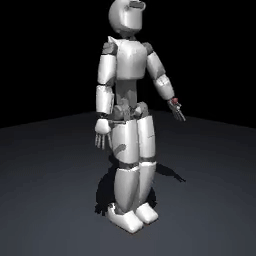
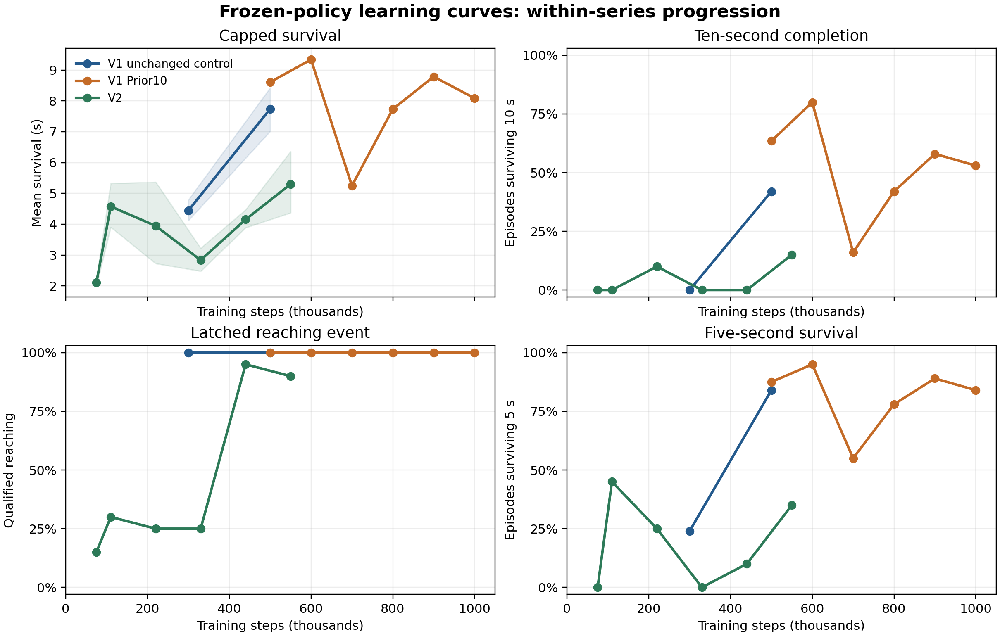
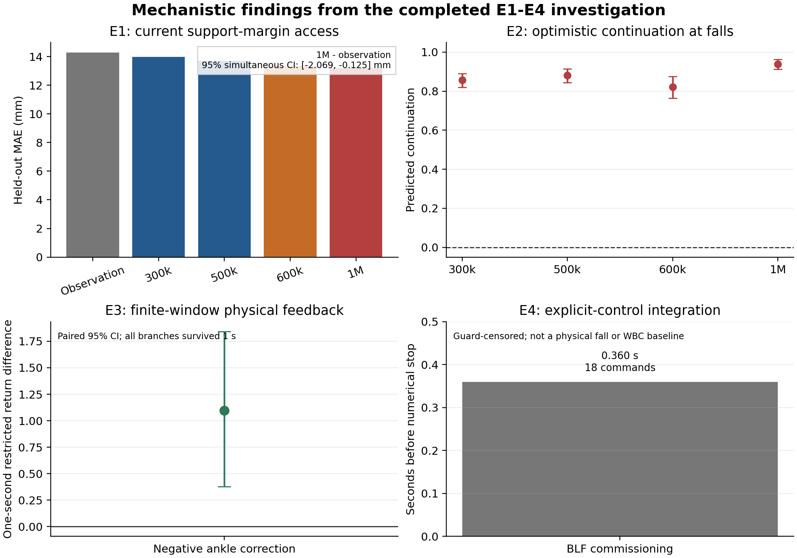

# DreamerV3 for ergoCub

Empirical investigation of DreamerV3, proprioception-dominant humanoid
control, and learned world models for a standard ergoCubSN001 in MuJoCo.



[](assets/demo/reaching-balance-500k.mp4)

The repository contains the public implementation surface, selected figures,
and a frozen record of results.

This release is organized around one question: how do representation,
prediction, imagined decision-making, and physical feedback relate in a
proprioception-dominant humanoid task? The completed investigation covers
DreamerV3 learning, representation (E1), prediction (E2), action and
closed-loop correction (E3), explicit control integration (E4), and a V2
control-interface/training comparison. The evidence supports useful local
mechanistic findings, but not a generally reliable humanoid controller.

Read the [research overview](docs/scientific_results.md) for the compact
results narrative, then the [reproducibility guide](docs/reproducibility.md)
for the boundary between checks supported by this repository and analyses
that require private checkpoints or trajectories.

## Research system

The task combines left-palm reaching with whole-body stabilization. The
environment exposes a 90-dimensional proprioceptive and task-state vector and
23 normalized joint position-reference actions at 50 Hz. The physics adapter
builds the standard ergoCubSN001 URDF, preserves its inertial model, uses the
four original sole-pad collision boxes, and applies the recorded experimental
servo settings. No pretrained humanoid controller supplies the behavior.

DreamerV3 encodes observations into a recurrent state-space model (RSSM). The
RSSM combines a deterministic recurrent state with a stochastic latent state,
predicts observation and reward consequences under actions, and supports
imagination without stepping MuJoCo. An actor and critic are trained on
imagined trajectories; the actor selects actions and the critic estimates
future return. This is a model-based reinforcement-learning study, not a claim
that the latent state is a complete physical model.

The upstream DreamerV3 source is pinned to HumanoidBench revision
`cb1189039151c8aadaaa987b442da54383c87fab`. The public launcher verifies that
revision before constructing an agent. The robot model and meshes are copied
from ergoCub software revision
`6c255e258cd184e91765b607222b6b6877bf7459`, with its BSD-3-Clause notice
retained under `assets/ergocub/`.

## Frozen results

These are verified results from one training lineage and separate frozen-policy
cohorts. They are reported for empirical traceability, not as generalization,
safety, or continual-learning claims.

| Policy/checkpoint and evaluation cohort | Mean survival, capped at 10 s | Reached target | Survived to 10 s |
| --- | ---: | ---: | ---: |
| DreamerV3 control, 300k (n=50; seeds 50-99) | 4.45 s | 100% | 0% |
| DreamerV3 control, 500k (n=50; seeds 50-99) | 7.74 s | 100% | 42% |
| Prior10, 500k (n=50; seeds 50-99) | 8.43 s | 100% | 56% |

The 200-episode Prior10 panel found a mean difference of +0.350 s with 95% CI
[-0.068, 0.770], so an additional mean-survival benefit was not established.
Prior10 continuation was non-monotonic: 600k reached 9.339 s, while 1M reached
8.086 s on the reused panel. The full curves and cohort labels are in
[learning-curves.png](assets/figures/learning-curves.png) and
[analysis/learning_curves.csv](analysis/learning_curves.csv).

## Experiment 1: latent representation analysis

E1 found limited linear accessibility of current support-margin information:
the 1M posterior reached 13.181 mm held-out MAE versus 14.278 mm for the
current observation baseline, with simultaneous 95% interval [-2.069, -0.125]
mm. This does not demonstrate physical understanding, prediction accuracy, or
improved control. E2-E4 and the full evidence boundaries are summarized in
[scientific results](docs/scientific_results.md).

## Mechanism summary

E2 found phase- and channel-dependent prediction errors with optimistic
continuation near actual falls. E3 found a positive one-second restricted-return
effect from a bounded ankle intervention, but no durable rescue. E4's BLF path
was guard-censored at 0.360 s and was not a successful WBC comparison. The
[mechanism figure](assets/figures/mechanistic-findings.png) shows the central
quantitative findings with only supported intervals.

V2's 550k cohort averaged 5.299 s survival, with 18/20 qualified reaching
episodes and 3/20 ten-second survivors. This was not better demonstrated
combined standing-and-reaching learning than V1: the cross-version cohorts,
control packages, and evaluation schedules are not matched or causally
comparable. Better nominal actuator tracking does not isolate the source of
learning differences. See [V1/V2 comparison](docs/v1_v2_comparison.md).





The gallery includes [V2 seed 1002](assets/demo/v2-550k-seed-1002-timeout.mp4),
a qualified reaching event followed by a 10-second timeout, and [V2 seed
1007](assets/demo/v2-550k-seed-1007-fall.mp4), a fall at 4.642 s. Both are from
the 550k frozen checkpoint; see [video_manifest.json](analysis/video_manifest.json)
for the checkpoint hash, file hashes, outcomes, and the warning that a latched
event is not sustained balance. Public artifact hashes and evidence identifiers
are collected in [public_provenance.json](analysis/public_provenance.json).

## Reproducibility boundary

**Reproducible from this repository:** asset hashes and URDF references,
physics construction, reset and actuator checks, environment interfaces,
Prior10 loss unit tests, and JSONL-to-TensorBoard conversion tests. These are
lightweight checks and do not perform training or optimizer updates.

**Reproducible analysis with external inputs:** frozen-policy evaluation,
latent probes, action-ranking diagnostics, and result figures require the
corresponding checkpoints, replay or trajectory files, and analysis scripts.
Those private artifacts are deliberately absent.

**Not claimed:** a fresh training reproduction, independent-seed uncertainty,
hardware transfer, disturbance robustness, self-collision handling, or
long-horizon stability. The simplified contact model and the 10-second cap are
important limitations.

Detailed setup, results, V1/V2 comparison, limitations, and the release audit
are collected in [`docs/`](docs/). The [release checklist](docs/release_checklist.md)
records what was tested, what is intentionally excluded, and what remains
blocked by private evidence.

## Setup and checks

From a clean checkout, create an isolated CPU environment and install the
pinned Dreamer requirements. TensorBoard is included because it is required by
the published analysis tests:

```bash
python3 -m venv .venv
.venv/bin/python -m pip install --upgrade pip uv
.venv/bin/uv pip sync --python .venv/bin/python configs/dreamer_requirements.lock
```

The physics validator intentionally reports exit status 2 when the unchanged
nominal hold falls; its geometry, reset, actuator-limit, and pulse checks still
record the measured failure and are the expected lightweight baseline result.

The launcher verifies the pinned upstream checkout. Obtain it at the expected
path and revision, then run the checks below:

```bash
git clone https://github.com/carlosferrazza/humanoid-bench.git vendor/humanoid-bench
git -C vendor/humanoid-bench checkout cb1189039151c8aadaaa987b442da54383c87fab
PYTHONPATH=scripts:vendor/humanoid-bench/dreamerv3 .venv/bin/python scripts/verify_assets.py
PYTHONPATH=scripts:vendor/humanoid-bench/dreamerv3 .venv/bin/python -m unittest scripts.test_prior_prediction scripts.test_jsonl_to_tensorboard
PYTHONPATH=scripts:vendor/humanoid-bench/dreamerv3 .venv/bin/python scripts/dreamer.py check --logdir /tmp/ergocub-readiness --platform cpu
PYTHONPATH=scripts .venv/bin/python scripts/plot_representation.py --output /tmp/experiment1-representation.png
PYTHONPATH=scripts .venv/bin/python scripts/plot_learning_curves.py --output /tmp/learning-curves.png
PYTHONPATH=scripts .venv/bin/python scripts/plot_mechanistic_findings.py --output /tmp/mechanistic-findings.png
```

The readiness command initializes and evaluates a policy without training. It
may still require a compatible JAX/Embodied installation. Do not place
checkpoints, replay, logs, virtual environments, or datasets in this checkout.

## References and licenses

- Hafner et al., *Mastering Diverse Domains through World Models*, DreamerV3:
  [project page](https://danijar.com/project/dreamerv3/).
- HumanoidBench DreamerV3 implementation:
  [pinned source](https://github.com/carlosferrazza/humanoid-bench/tree/cb1189039151c8aadaaa987b442da54383c87fab/dreamerv3).
- ergoCub software and model source:
  [pinned revision](https://github.com/mesh-iit/ergocub-software/tree/6c255e258cd184e91765b607222b6b6877bf7459/urdf/ergoCub/robots/ergoCubSN001).
- MuJoCo: [mujoco.org](https://mujoco.org/).

Original repository contributions are covered by [LICENSE](LICENSE). Third-party
licenses and attribution notices remain with their respective works.