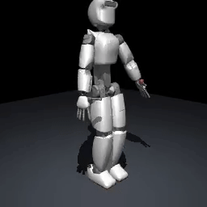
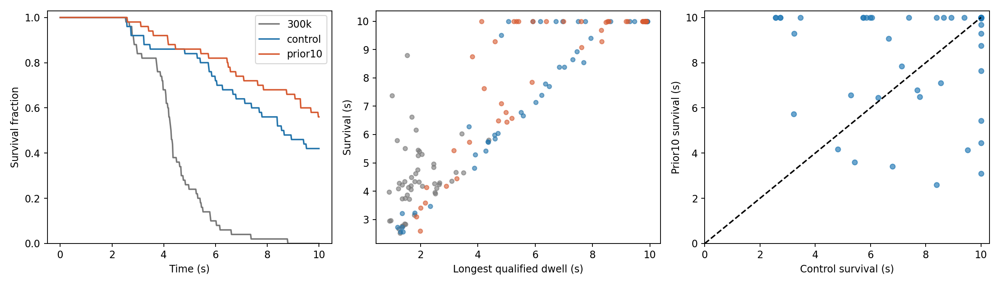
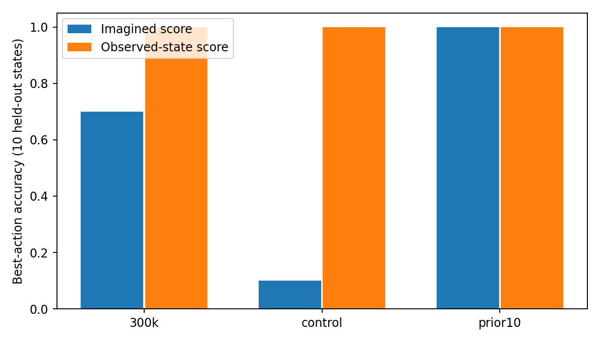

# Dreamer-ergo-worldmodel

**Learning humanoid reaching and stabilization through world models.**

*An existing evaluation recording of the unchanged 500k policy: the first
completed episode, selected by episode order, reaches the target and survives
to the 10-second cap. This illustrative successful episode is not a performance
estimate; failures are included in the comparisons below. [Full MP4](assets/demo/reaching-balance-500k.mp4).*

## Overview

DreamerV3 learns a compact model of how observations evolve under actions. It
uses this model to imagine trajectories, estimate future returns, and train an
actor–critic policy before applying actions in the simulator.

This POC uses the [official HumanoidBench DreamerV3 implementation](https://github.com/carlosferrazza/humanoid-bench/tree/cb1189039151c8aadaaa987b442da54383c87fab/dreamerv3)
with a custom standard **ergoCubSN001** reaching-and-balance task in MuJoCo.
The policy issues 23 joint-level position-reference commands at 50 Hz. The task
combines left-palm reaching with whole-body stabilization; no pretrained
humanoid controller supplies the behavior. The nominal target is 5 cm ahead of
the initial left palm. These are task-specific POC results, not HumanoidBench
benchmark scores. This repository contains selected
results and media, not the training implementation or reproducibility package.

## Experimental results

All step counts are total driver steps. The following comparison uses **50
matched completed episodes per frozen policy, policy seeds 50–99**, identical
nominal resets, stochastic actions with independently reset policy RNG/carry,
and a 10-second episode cap.

| Metric | 300k | DreamerV3 500k | Prior10 500k |
|---|---:|---:|---:|
| Mean survival, capped at 10 s | 4.45 s | 7.74 s | 8.43 s |
| Qualified reaching success | 100% | 100% | 100% |
| Survived to 10 s | 0% | 42% | 56% |

Qualified success requires the palm within 3 cm of the target for 0.5 continuous
seconds, root tilt below 20 degrees, and root height above 90% of its reset
height. It is an
episode-level event, not proof of continuous reaching or balance afterward.
Episodes stopped at 10 seconds are right-censored for longer-term survival.

*The same 50-seed cohort: survival curves, longest qualified dwell versus survival,
and paired control/Prior10 outcomes. Control is unchanged DreamerV3. Both 500k
branches continued from the same 300k learning state.*

Unchanged training from 300k to 500k increased mean capped survival by **3.29 s**
(paired seed-bootstrap 95% CI **[2.54, 4.03]**). Prior10 minus unchanged 500k was
**+0.69 s [−0.24, 1.63]**, leaving its additional mean-survival benefit uncertain.

### Separate expanded validation

An independent cohort of **200 new matched policy seeds, 100–299**, compared
only the frozen 500k policies under the same conditions. These results are not
pooled with the preceding 50 episodes.

| Metric | DreamerV3 500k | Prior10 500k |
|---|---:|---:|
| Mean survival, capped at 10 s | 8.26 s | 8.61 s |
| Survived to 10 s | 47% | 63.5% |
| Qualified reaching success | 100% | 100% |
| Leftward falls, fraction of all episodes | 1% | 21.5% |

The paired mean-survival difference was **+0.350 s, 95% CI [−0.068, 0.770]**:
**a mean-survival advantage is not statistically established**. The 10-second
completion difference was **+16.5 percentage points [8.0, 25.0]**, supporting an
advantage at that cap. Rearward falls decreased (48% to 12.5%), while leftward
falls increased by **20.5 percentage points [15.0, 26.5]**. Intervals use matched
seed-pair bootstrap resampling and are not adjusted for multiple endpoints.

## Research hypothesis: Prior10

The experimental Prior10 branch adds **0.1-weighted supervision of 10-step
open-loop prior predictions** against recorded observations, rewards, and
continuation. The hypothesis is that more reliable imagined dynamics can improve
the decisions used for balance. This auxiliary objective is an intervention,
not part of the unchanged upstream DreamerV3 baseline.

*Held-out diagnostic seeds 10–19: three predefined ankle-pitch interventions at
each of ten shared physical states. Imagined-score best-action agreement with
the physics-grounded ordering was 7/10, 1/10, and 10/10 for 300k, unchanged 500k, and Prior10,
respectively. Observed-state scores use physics observations with the same
model's critic; this small open-loop diagnostic does not establish general
action-ranking reliability. Prediction calibration remained mixed.*

## Limitations and next evaluation

- One training seed per branch, with a shared 300k ancestor; policy-sampling
  seeds do not measure variability across independent training runs.
- Fixed nominal reaching target and reset conditions; no established disturbance
  robustness, hardware transfer, or indefinite balancing.
- Ten-second cap; improved completion does not establish longer-term stability.
- Simplified sole-pad contacts and conservative fall guards; no self-collision
  or non-foot body-ground collision response.
- Mixed world-model calibration and a lateral-failure tradeoff. Recovery and
  CUDA execution-workaround differences also limit strict causal attribution.

A future 1,000,000-step evaluation will add matched survival statistics and a
new recording against the preserved 500k policies. **No 1M result is reported here.**

## Credits, provenance, and license

- [HumanoidBench](https://github.com/carlosferrazza/humanoid-bench): the upstream
  DreamerV3 implementation used for the unchanged baseline, pinned above.
- [DreamerV3](https://danijar.com/project/dreamerv3/), *Mastering Diverse Control
  Tasks through World Models*, by Danijar Hafner, Jurgis Pasukonis, Jimmy Ba,
  and Timothy Lillicrap; [original code](https://github.com/danijar/dreamerv3).
- [MuJoCo](https://mujoco.org/): physics simulation.
- [ergoCub](https://ergocub.eu/): robot project; public
  [ergoCubSN001 model source](https://github.com/mesh-iit/ergocub-software/tree/6c255e258cd184e91765b607222b6b6877bf7459/urdf/ergoCub/robots/ergoCubSN001),
  revision `6c255e258cd184e91765b607222b6b6877bf7459`.

The demo exports the first completed episode of the unchanged 500k policy's
ordinary evaluation, separate from the matched-seed cohorts. The MP4 preserves
the original recorded frames; the GIF is a full-episode preview at reduced frame
rate and original playback speed. Figures are existing analysis exports with
unchanged pixels and removed metadata. No upstream code or robot model/meshes
are redistributed. Original showcase content uses MIT; the BSD-3-Clause robot
source notice is retained in [LICENSE](LICENSE). Third-party licenses remain
with their respective works. This independent POC implies no affiliation or
endorsement by the credited projects.
